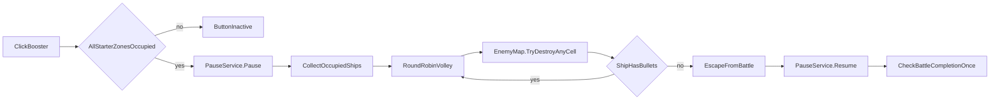

<!-- workai:plan:create id="boosters-implementation" -->

## План: Реализация бустеров по типам

Четыре бустера (`EscapeSelected`, `DeleteColor`, `ExtraSlot`, `Volley`) с общим абстрактным слоем, отдельными SO-конфигами цен и UI покупки; плюс сервис паузы и отложенная проверка победы, без которых `Volley` ломает машину состояний и `Time.timeScale`.

### Проблема
Сейчас `BoosterView` — пустая заглушка с enum внутри, `BoosterHolder.Init()` только строит словарь, валюта умеет лишь `Add`, а `Time.timeScale` пишет исключительно `GameTimeHandler`. Для залпа не хватает трёх вещей: признака «стартовая зона» в `WaitingZone` (после `UnlockZone` разница стирается), способа остановить все корабли и способа уничтожить блок не на конце цепочки (`TryGetTargetCellIndex` смотрит только `_firstInRows`/`_lastInRows`).

### Связанные файлы
- [Assets/Scripts/Core/Waiting/WaitingZone.cs](Assets/Scripts/Core/Waiting/WaitingZone.cs) — добавить `IsStarter` (фиксируется в конструкторе, не меняется в `SetLocked`) и `IsOccupied` (`_ship != null`).
- [Assets/Scripts/Core/Waiting/IWaitingZonesController.cs](Assets/Scripts/Core/Waiting/IWaitingZonesController.cs) — расширить: `AreAllStarterZonesOccupied`, `IReadOnlyList<Transform> OccupiedShips`.
- [Assets/Scripts/Core/Waiting/WaitingZonesController.cs](Assets/Scripts/Core/Waiting/WaitingZonesController.cs) — реализация этих двух членов по `_zones` и `_reservations`; `unlockedCount` в конструкторе уже даёт разбиение стартовых зон.
- [Assets/Scripts/Core/GamePauseService.cs](Assets/Scripts/Core/GamePauseService.cs) — новый сервис, единственный владелец `Time.timeScale`: `IsPaused`, `Pause`, `Resume`, `ForceResume`, `ApplyTimeScale`.
- [Assets/Scripts/Core/GameTimeHandler.cs](Assets/Scripts/Core/GameTimeHandler.cs) — перестать писать `Time.timeScale`, отдавать `_initialTimeScale * multiplier` в `GamePauseService`.
- [Assets/Scripts/Core/GameSessionHandler.cs](Assets/Scripts/Core/GameSessionHandler.cs) — принимать сервис в конструктор, `ForceResume()` в `Dispose` (иначе следующая сцена стартует с нулевым timeScale).
- [Assets/Scripts/Core/Enemy/EnemyMap.cs](Assets/Scripts/Core/Enemy/EnemyMap.cs) — `TryDestroyAnyCell(int colorIndex)` с курсором обхода и обёрткой, `DestroyColor(int)`, `TryGetColorIndex(Cell, out int)`, `GetActiveColors()`; удаление только по `_cellLinks` с проверкой `IsActive`.
- [Assets/Scripts/Core/Ship/ShipShooterProvider.cs](Assets/Scripts/Core/Ship/ShipShooterProvider.cs) — `TryVolleyShoot(int colorIndex)` через `EnemyMap.TryDestroyAnyCell`.
- [Assets/Scripts/Core/Ship/Ship.cs](Assets/Scripts/Core/Ship/Ship.cs) — `TryVolleyShoot()`, `ForceRemoveFromParking()`, `StartVolleyRoutine/StopVolleyRoutine`; существующий `Shoot()` уже сам уводит в `EscapeFromBattle` при нуле патронов.
- [Assets/Scripts/Ship/ShipView.cs](Assets/Scripts/Ship/ShipView.cs) — отдельное поле `_volleyRoutine` + `StartVolleyRoutine/StopVolleyRoutine`, метод `Hide()`.
- [Assets/Scripts/Core/Ship/States/ShipStateMachine.cs](Assets/Scripts/Core/Ship/States/ShipStateMachine.cs) — зарегистрировать `VolleyState` в `_states`, иначе `ChangeState` молча ничего не сделает.
- [Assets/Scripts/Core/Ship/States/VolleyState.cs](Assets/Scripts/Core/Ship/States/VolleyState.cs) — новое состояние: цикл выстрелов на `WaitForSecondsRealtime`, `Exit()` останавливает рутину.
- [Assets/Scripts/Core/Ship/ShipsController.cs](Assets/Scripts/Core/Ship/ShipsController.cs) — `_battleSlots` вместо `const ShipsInBattle`, `IncreaseBattleSlots`, `TryEnterBattle(ship, ignoreLimit)`, `TryGetShip(Transform)`, `RemoveParkingShipsByColor`, `_completionSuspended` + `CheckBattleCompletion()`.
- [Assets/Scripts/Core/Ship/IShipsController.cs](Assets/Scripts/Core/Ship/IShipsController.cs) — новые члены контроллера.
- [Assets/Scripts/Core/Currency/ISoftCurrencyController.cs](Assets/Scripts/Core/Currency/ISoftCurrencyController.cs) и [Assets/Scripts/Core/Currency/SoftCurrencyController.cs](Assets/Scripts/Core/Currency/SoftCurrencyController.cs) — `bool TrySpend(int)` с `SetBalance`.
- [Assets/Scripts/Core/Boosts/BoosterView.cs](Assets/Scripts/Core/Boosts/BoosterView.cs) и [Assets/Scripts/Core/Boosts/BoosterHolder.cs](Assets/Scripts/Core/Boosts/BoosterHolder.cs) — переписать под контроллер, count/price и попап покупки.
- Новые файлы в [Assets/Scripts/Core/Boosts](Assets/Scripts/Core/Boosts): `BoosterType.cs`, `BoosterConfigSO.cs` + `EscapeSelectedBoosterConfigSO.cs`, `DeleteColorBoosterConfigSO.cs`, `ExtraSlotBoosterConfigSO.cs`, `VolleyBoosterConfigSO.cs`, `IBooster.cs`, `BoosterBase.cs`, `EscapeSelectedBooster.cs`, `DeleteColorBooster.cs`, `ExtraSlotBooster.cs`, `VolleyBooster.cs`, `BoosterContext.cs`, `BoosterFactory.cs`, `BoostersController.cs`, `BoosterBuyPopup.cs`.
- [Assets/Scripts/Core/Root.cs](Assets/Scripts/Core/Root.cs) — создать `GamePauseService`, передать в `GameSessionHandler`, инициализировать бустеры, заменить две подписки на `MouseClicked` одной.

### Поток

Активация `Volley`: условие по стартовым зонам, пауза, сбор кораблей, round-robin обход блоков, снятие паузы и одна проверка победы в конце.

**Шаги**
1. Добавить в `WaitingZone` свойства `IsStarter` и `IsOccupied`, а в `IWaitingZonesController`/`WaitingZonesController` — `AreAllStarterZonesOccupied` и `OccupiedShips` (все занятые зоны, включая открытые за рекламу).
2. Создать `GamePauseService` и перевести на него `GameTimeHandler` так, чтобы `Time.timeScale` писал только сервис; добавить `ForceResume` в `GameSessionHandler.Dispose`.
3. Добавить в `GameSessionHandler` конструктор с сервисом паузы и обновить вызов в `Root`.
4. Переделать `ShipsController`: лимит боёв в поле `_battleSlots`, `IncreaseBattleSlots`, `TryEnterBattle` с флагом обхода лимита, `TryGetShip(Transform)`.
5. Добавить в `ShipsController` `RemoveParkingShipsByColor` и `ForceRemoveFromParking` в `Ship`/`ShipView` (освобождение клеток стоянки без `CompleteMission`).
6. Ввести в `ShipsController` `_completionSuspended` + `CheckBattleCompletion()` и перевести `OnShipCompleted` на него; при пустом `_ships` и пустом `_activeShips` считать бой завершённым, защитившись флагом `_initialized`.
7. Добавить в `EnemyMap` `TryDestroyAnyCell` с курсором по кругу, `DestroyColor`, `TryGetColorIndex`, `GetActiveColors`.
8. Создать `VolleyState` с циклом выстрелов на `WaitForSecondsRealtime` и зарегистрировать его в `ShipStateMachine`.
9. Добавить `TrySpend` в `ISoftCurrencyController` и `SoftCurrencyController`.
10. Собрать слой `Boosts`: `BoosterType`, абстрактный `BoosterConfigSO` с четырьмя наследниками, `IBooster`/`BoosterBase` с четырьмя эффектами, `BoosterContext`, `BoosterFactory`, `BoostersController` (счётчики в PlayerPrefs, покупка, режим выбора цели, `IEnumerator RunVolley`).
11. Написать `BoosterView` (count/price, `interactable`, подсветка активного режима), `BoosterBuyPopup` и переписать `BoosterHolder` (`Init` с конфигами, запуск корутины залпа).
12. Обновить `Root`: создание сервисов, `BoosterHolder.Init`, единый обработчик клика с приоритетом «бустер → корабль → зона».

**Проверка**
1. Компиляция проекта без ошибок и предупреждений в затронутых файлах.
2. `EscapeSelected`: корабль без чистого выхода выпускается, слот боя занимается даже при 5 активных.
3. `DeleteColor`: блоки цвета и корабли этого цвета исчезают одновременно; если кораблей не осталось — `WinPopup` показывается один раз.
4. `ExtraSlot`: после применения в бою держатся 6 кораблей, `HasFreeBattleSlot` и ускорение времени ведут себя согласованно.
5. `Volley`: кнопка неактивна при свободной стартовой зоне; при всех занятых — все корабли замирают, блоки исчезают по одному без повторных удалений, корабли уходят, пауза снимается, победа проверяется однократно.
6. Покупка: при `count == 0` клик открывает панель, при нехватке валюты кнопка бустера неактивна, после покупки `count == 1` и цена скрывается.
7. Выход из сцены во время залпа: `Time.timeScale` возвращается к исходному.

**Решения**
- `Blend` удаляется из enum, `Recolor` не реализуется — состояние «корабль без блоков своего цвета» невозможно из-за баланса генерации.
- Порядок значений enum: `EscapeSelected = 0`, `DeleteColor = 1`, `ExtraSlot = 2`, `Volley = 3`; `BoosterView`-объектов в сцене пока нет, сдвиг безопасен.
- Условие `Volley` — заняты только стартовые зоны (`IsStarter`), открытые за рекламу не учитываются; залп при этом бьёт по всем занятым зонам.
- Баланс `Volley` решается ценой в SO и порогом заполненности зон, без ограничения числа кораблей за применение.
- Анимация залпа идёт на нескалированном времени, остальные корабли стоят за счёт `timeScale = 0` — `Mover`, `WaitForSeconds` в `WaitingState` и `DOMove` в `MoveToBattle` замереть обязаны.
- Проверка победы откладывается до конца залпа, чтобы `WinPopup` не открывался при нулевом `timeScale`.
- Сцена не меняется: `BoosterHolder` и `BoosterView` берутся существующие, `BoosterBuyPopup` находится через `FindObjectOfType(..., true)` по образцу `WinPopup`, конфиги SO перечисляются списком внутри `BoosterHolder`.